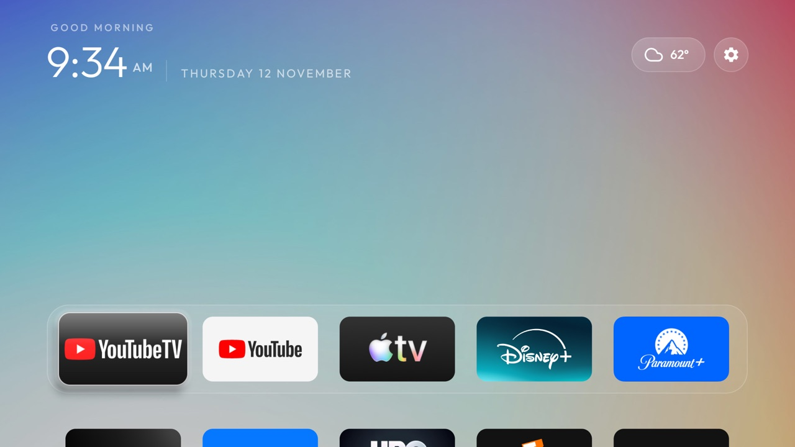

# Weather pill

The weather now, as a small grey pill beside the launcher's Settings gear: a white line icon for the conditions and
the temperature. This add-on fetches the weather; the launcher shows it (`weather_pill_authority` in the launcher's
`config.xml`), so the launcher itself still has no network access.



- **Data** comes from [Open-Meteo](https://open-meteo.com/), which needs no account or key.
- **No background work.** There is no screen, service, job or boot receiver. The launcher asks for the weather
  once a minute while Home is on screen, and the add-on fetches only when its last reading is over 30 minutes
  old (5 minutes after a failure). A reading over 3 hours old is not shown: the pill hides.
- **Icons**: sun, moon, partly cloudy (day and night), cloudy, fog, drizzle, rain, snow and thunderstorm, as white
  line art that the launcher tints like its other pills. From [Feather](https://feathericons.com/) (MIT) and
  [Lucide](https://lucide.dev/) (ISC); fog is drawn here.

## Set the place

The place is fixed at build time, in `app/src/main/res/values/config.xml`:

| Value | What it is |
|---|---|
| `latitude`, `longitude` | Decimal degrees, two decimals (about 1 km) are plenty. While either is empty the add-on fetches nothing and the pill stays hidden. |
| `unit` | `fahrenheit` or `celsius` |

[PROMPT.md](../../PROMPT.md) asks the TV owner for their city or postcode and fills these in.

## Permissions

| Permission | Why |
|---|---|
| `INTERNET` | Open-Meteo: the current temperature and weather code for the place above. |

That is all. What is sent: the latitude and longitude above. No account, no telemetry, no location permission.

## Build and install

JDK 17 and Android SDK platform 34 with build-tools 34.0.0, as for the launcher:

```bash
cd addons/weather-pill && ./gradlew assembleRelease
TV_HOST=<tv ip> ../../tools/venv/bin/python -I ../../tools/tv.py --push app/build/outputs/apk/release/app-release.apk /data/local/tmp/addon.apk
TV_HOST=<tv ip> ../../tools/venv/bin/python -I ../../tools/tv.py 'pm install -r /data/local/tmp/addon.apk; rm -f /data/local/tmp/addon.apk'
```

Press Home: the pill appears within a minute, once the first reading is in. Check it from the shell with
`content query --uri content://io.github.gogoguerilla.weatherpill.now`.

The release build is signed with the debug key so it installs over ADB like the launcher.

## Tested on

Sony BRAVIA 4K GB (BRAVIA_ATV2), Android TV 9.

## Maintainer

[@gogoguerilla](https://github.com/gogoguerilla)
